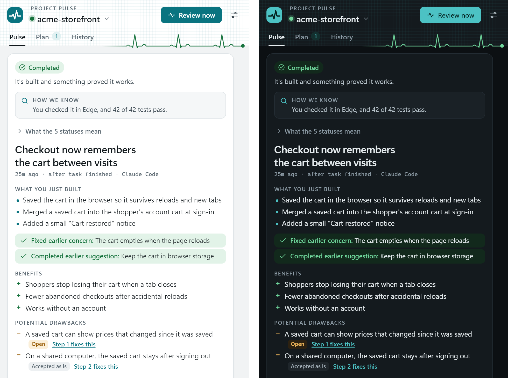
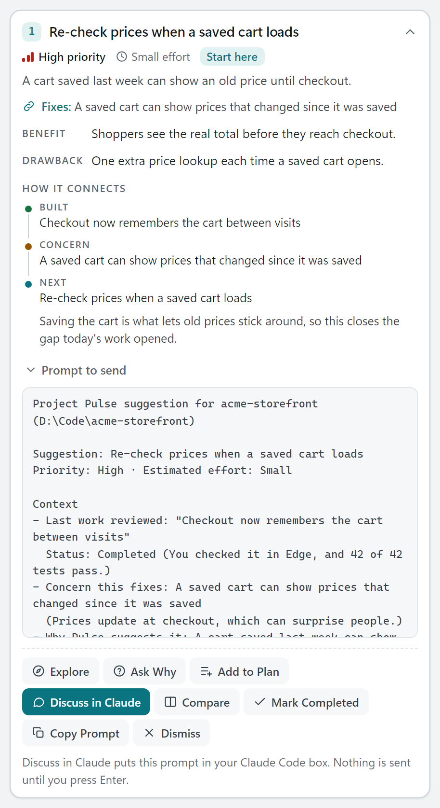
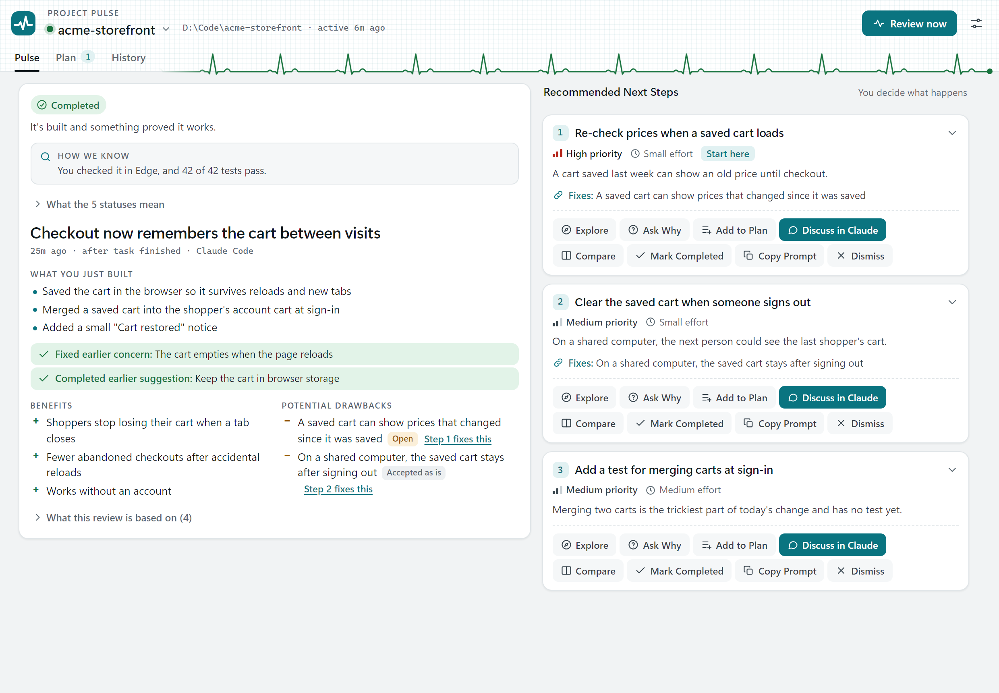
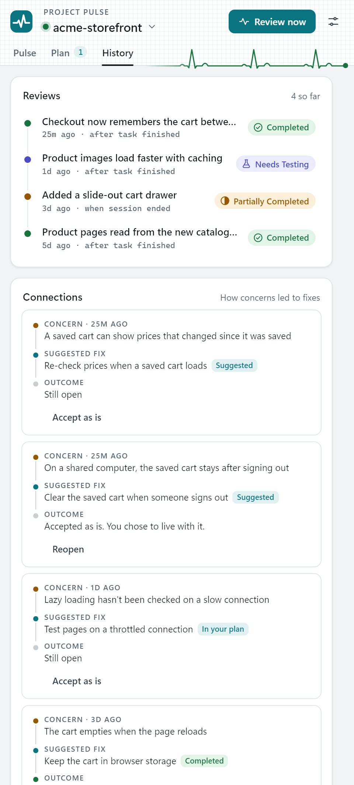
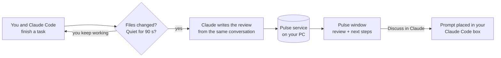

# Project Pulse

**Finish a task with Claude Code, and get a 30-second review of what you just built.**

Pulse watches your Claude Code sessions. When a coding task is done, it writes a short, plain-English review in its own window:
- what you built
- whether it's really finished, and how we know
- what's good about it
- what could go wrong
- the next three steps worth taking

It remembers every project, so the next review knows what you already fixed, planned or turned down.



*Screenshots use Pulse's built-in sample data.*

---

## Why use it

- **You stop guessing whether something is done.** Every review gets a status: Completed, Partially Completed, Needs Testing, Blocked, or No Meaningful Changes. Under it, a "How we know" line gives the evidence, like "No tests were run" or "42 of 42 tests pass".
- **Problems come with fixes attached.** Each drawback links to the next step that fixes it ("Step 1 fixes this"). Pulse suggests fixes for what you just built before it suggests new features.
- **It explains in plain words.** Reviews are written so someone who doesn't code, like a client, a teacher or a teammate, can follow them.
- **It never touches your code.** Pulse only advises. To act on a suggestion, **Discuss in Claude** puts a detailed prompt in your Claude Code box. Nothing is sent until you press Enter.
- **It remembers.** History connects work to concerns to fixes across sessions, and suggestions you finished or dismissed never come back.
- **It stays out of your way.** The window opens only after you stop typing, and if it's already open it updates quietly.

## What a next step looks like

Each suggestion explains why it matters, what it costs, and what it fixes. It also carries a ready-to-send prompt that asks Claude to check the problem is real, compare options, and wait for your go-ahead.



On a wide window, the next steps sit beside the review:



History shows every review and how each concern led to a fix:



---

## How it works



1. **A small Claude Code mod notices when a task is really done.** "Done" means Claude finished a reply that changed files, and you then stayed quiet for about 90 seconds. A successful `git commit` counts as done sooner. Ending the session counts too.
2. **The review comes from the session itself.** Pulse asks the same conversation a short side question, so the reviewer saw exactly what happened. It uses the Claude sign-in you already have, with no API key.
3. **A local service saves it and shows it.** The service runs on `127.0.0.1` and stores everything in SQLite. It opens the Pulse window, a small Edge app window.

---

## Install (Windows 10/11)

**You need:**
- [Node.js](https://nodejs.org) 22.5 or newer
- [Claude Code](https://claude.com/claude-code)
- Microsoft Edge (already on Windows) or Chrome

```bash
git clone https://github.com/Leromem/project-pulse.git
```

```bash
cd project-pulse
```

Then double-click **`Install.cmd`**, or run:

```bash
powershell -ExecutionPolicy Bypass -File install.ps1
```

That's it. Pulse is now on for **every** Claude Code project, current and future. New sessions pick it up automatically; in a session that's already open, run `/reload-plugins`.

**Optional, for Claude Desktop chats:** double-click `dist\ProjectPulse.mcpb`. Or in Claude Desktop, go to Settings > Extensions > Advanced > Install Extension and pick that file.

**Optional, so Pulse can finish reviews after you close Claude:** run `claude auth login` once in a terminal.

<details>
<summary>What the installer changes</summary>

| Where | Change |
| --- | --- |
| `%USERPROFILE%\.project-pulse\app` | The app: service, window, mod, MCP server |
| `%USERPROFILE%\.project-pulse\data` | Your reviews database, settings, logs and a random local access code. Only your Windows account can read it. |
| Claude Code user settings | Adds the local marketplace `project-pulse-local` and enables the plugin `project-pulse`. Your settings are backed up to `data\backups\` first. |
| Startup folder | Starts the Pulse service when you sign in |
| Start menu | A **Project Pulse** shortcut that opens the window |

It doesn't touch your projects or your Claude Desktop config.
</details>

## Use it

| Want to… | Do this |
| --- | --- |
| Get a review now | Type `/pulse` in Claude Code, or press **Review now** in the window |
| Open the window | `/pulse open`, or the Start menu entry **Project Pulse** |
| Turn automatic reviews off for this project | `/pulse off` (and `/pulse on` to turn them back on) |
| Turn them off everywhere | `/pulse off all` (and `/pulse on all`) |
| See what's on | `/pulse status` |
| Review a chat in Claude Desktop | Ask: *"Give me a Project Pulse review of C:\path\to\project"* |

Every next step has eight buttons: **Explore**, **Ask Why**, **Add to Plan**, **Compare**, **Dismiss**, **Mark Completed**, **Discuss in Claude**, and **Copy Prompt**. The **Plan** tab keeps your backlog.

**Settings** (the sliders icon) let you change these, globally or per project:
- automatic reviews
- whether the window opens by itself
- how many suggestions to show (1–3)
- how detailed the explanations are
- notifications, animations, theme
- the quiet time before a review

Want a look before you have any reviews? Open `http://127.0.0.1:47821/?demo=1` after installing.

## Privacy and safety

- **Everything stays on your PC.** The service only listens on `127.0.0.1`, needs a random access code, and refuses requests from web pages.
- **It reads file names, not file contents.** Commands and short snippets of the conversation are saved for later reviews. Anything that looks like a key, token or password is removed first.
- **No API key, no telemetry, no outside servers.** Reviews use your existing Claude sign-in.
- **Nothing runs from a suggestion.** Pulse never edits files or sends prompts by itself.
- **If Pulse breaks, Claude carries on normally.** Every hook fails safely.

## Good to know

- **Windows only for now:** the installer, the window and the background service use Windows features.
- **Claude Desktop chats have no "finished" signal,** so reviews there are on request.
- **Some reviews need an open Claude Code session:** reviews written after a session ends use the `claude` CLI's sign-in. Without it, the next open Claude Code session writes them.
- **The Claude Code mod API is marked early access.** If an update ever changes it, Claude keeps working and Pulse's log says why.

## Uninstall

Double-click **`Uninstall.cmd`**. It stops Pulse, removes the plugin, shortcuts and app, and backs up your Claude settings first.
- Your review history stays in `%USERPROFILE%\.project-pulse\data` unless you run `uninstall.ps1 -RemoveData`.
- In Claude Desktop, remove **Project Pulse** under Settings > Extensions.

## Develop

```
service/            Node service: HTTP + live events, SQLite, review prompts, window
ui/                 The window (plain HTML/CSS/JS; add ?demo=1 for sample data)
plugin/             The Claude Code mod (hooks/register.ts), its tests, the MCP server
desktop-extension/  Manifest for the Claude Desktop extension
bin/                Hidden launchers used by the shortcuts
test/               Scenario tests
docs/API.md         The local API
```

- `npm test` runs the scenario tests: finished vs. ongoing tasks, session end, several projects at once, failures and retries, restarts, privacy and security.
- `claude plugin test plugin` runs the mod's tests inside Claude Code's own engine.
- `claude plugin validate plugin` checks the mod the way Claude Code loads it.

No runtime dependencies: just Node's built-ins, including `node:sqlite`.

## License

[MIT](LICENSE) © 2026 Juryen Ragas
