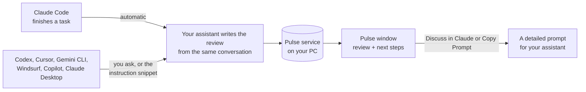

# Project Pulse

**Finish a coding task with your AI assistant, and get a 30-second review of what you just built.**

Works with **Claude Code, Codex, Cursor, Gemini CLI, Windsurf, VS Code Copilot and Claude Desktop**.

When a coding task is done, Pulse writes a short, plain-English review in its own window:
- what you built
- whether it's really finished, and how we know
- what's good about it
- what could go wrong
- the next three steps worth taking

It remembers every project, so the next review knows what you already fixed, planned or turned down.

Every tool shares one window and one memory. In Claude Code, reviews happen automatically. In the others, you ask for one, or add a one-line instruction and they happen automatically too ([see how](#works-with)).


*Screenshots use Pulse's built-in sample data.*

---

## Why use it

- **You stop guessing whether something is done.** Every review gets a status: Completed, Partially Completed, Needs Testing, Blocked, or No Meaningful Changes. Under it, a "How we know" line gives the evidence, like "No tests were run" or "42 of 42 tests pass".
- **Problems come with fixes attached.** Each drawback links to the next step that fixes it ("Step 1 fixes this"). Pulse suggests fixes for what you just built before it suggests new features.
- **It explains in plain words.** Reviews are written so someone who doesn't code, like a client, a teacher or a teammate, can follow them.
- **It never touches your code.** Pulse only advises. To act on a suggestion, **Discuss in Claude** puts a detailed prompt in your Claude Code box. **Copy Prompt** gives you the same prompt for any other assistant. Nothing is sent until you press Enter.
- **It remembers.** History connects work to concerns to fixes across sessions, and suggestions you finished or dismissed never come back.
- **It stays out of your way.** The window opens only after you stop typing, and if it's already open it updates quietly.

## Works with

| Tool | How reviews happen | Setup |
| --- | --- | --- |
| **Claude Code** (CLI and desktop app) | **Automatically** after each finished task, or `/pulse` | Done by the installer |
| **Codex CLI** (OpenAI) | When you ask, or automatically with the optional instruction snippet | Done by the installer if Codex is on your PC |
| **Cursor** | When you ask | Done by the installer if Cursor is on your PC |
| **Gemini CLI** | When you ask, or automatically with the instruction snippet | Done by the installer if Gemini CLI is on your PC |
| **Windsurf** | When you ask | Done by the installer if Windsurf is on your PC |
| **VS Code (GitHub Copilot agent mode)** | When you ask | Done by the installer if VS Code is on your PC |
| **Claude Desktop** | When you ask | Open `dist/ProjectPulse.mcpb` |
| **Any other MCP client** | When you ask | [Add the server by hand](#any-ai-tool-by-hand) |

All of them share the same Pulse window, project memory and plan. "When you ask" means you say *"give me a Pulse review"* and the assistant writes it with the Pulse tools.

## What a next step looks like

Each suggestion explains why it matters, what it costs, and what it fixes. It also carries a ready-to-send prompt that asks Claude to check the problem is real, compare options, and wait for your go-ahead.


On a wide window, the next steps sit beside the review:


History shows every review and how each concern led to a fix:


---

## How it works



1. **Pulse finds out a task is done.**
   - In Claude Code, a small mod notices on its own. "Done" means Claude finished a reply that changed files, and you then stayed quiet for about 90 seconds. A successful `git commit` counts sooner, and so does ending the session.
   - In other tools, the assistant calls Pulse's tools when you ask, or by itself when you add the instruction snippet.
2. **The review comes from the conversation itself,** so the reviewer saw exactly what happened. It uses the sign-in your assistant already has. Pulse never needs its own API key.
3. **A local service saves it and shows it.** The service runs on `127.0.0.1` and stores everything in SQLite. It opens the Pulse window, a small Edge or Chrome app window.

---

## Install

**Pick your system below.** Each box holds one command; paste them one at a time.

| | Windows 10/11 | macOS | Linux |
| --- | --- | --- | --- |
| Where to type | PowerShell or Command Prompt, or no terminal at all | Terminal | Terminal |
| Install | `.\Install.cmd` (or double-click it) | `sh install.sh` | `sh install.sh` |
| Uninstall | `Uninstall.cmd` | `sh ~/.project-pulse/app/uninstall.sh` | `sh ~/.project-pulse/app/uninstall.sh` |
| Status | Tested | New, [not yet tested on real hardware](#macos) | New, [not yet tested on real hardware](#linux) |

**Every system needs:**
- [Node.js](https://nodejs.org) 22.5 or newer
- At least one AI coding tool:
  - [Claude Code](https://claude.com/claude-code), for fully automatic reviews
  - and/or Codex CLI, Cursor, Gemini CLI, Windsurf, VS Code Copilot or Claude Desktop
- Microsoft Edge, Google Chrome or Chromium for the Pulse window. Windows already has Edge.

### Windows

**Without a terminal:**
1. On this page, click **Code > Download ZIP**, then unzip it.
2. Open the folder and double-click **`Install.cmd`**.

**With PowerShell or Command Prompt:**

```powershell
git clone https://github.com/Leromem/project-pulse.git
```

```powershell
cd project-pulse
```

```powershell
.\Install.cmd
```

> Windows PowerShell doesn't understand `&&`, so don't chain these into one line. Run them one at a time as shown.

Pulse starts with Windows from now on. To open the window, use **Project Pulse** in the Start menu or `/pulse open` in Claude Code.

### macOS

> **Not yet tested on real hardware.** Every macOS code path has unit tests, but nobody has run Pulse on a real Mac yet. If you try it, please [open an issue](https://github.com/Leromem/project-pulse/issues) and say what worked.

In **Terminal**:

```bash
git clone https://github.com/Leromem/project-pulse.git
```

```bash
cd project-pulse
```

```bash
sh install.sh
```

- **Starts at login** through a LaunchAgent: `~/Library/LaunchAgents/com.project-pulse.service.plist`.
- **To open the window,** run `/pulse open` in Claude Code, or `sh ~/.project-pulse/app/bin/open-window.sh`.
- **Notifications** come through `osascript`. In System Settings > Notifications they may be listed under Script Editor.
- **For Claude Desktop,** open `~/.project-pulse/app/dist/ProjectPulse.mcpb`.

### Linux

> **Not yet tested on real hardware.** The install and uninstall were run start to finish in a simulated Linux environment, but not yet on a real desktop. If you try it, please [open an issue](https://github.com/Leromem/project-pulse/issues).

In a terminal:

```bash
git clone https://github.com/Leromem/project-pulse.git
```

```bash
cd project-pulse
```

```bash
sh install.sh
```

- **Starts at login** through `~/.config/autostart/project-pulse.desktop`.
- **To open the window,** use **Project Pulse** in your app menu, `/pulse open` in Claude Code, or `sh ~/.project-pulse/app/bin/open-window.sh`.
- **Optional extras:**
  - `xprintidle` so the window waits until you stop typing. It works on X11 only; without it, the window opens right away.
  - `notify-send` for notifications.
  - `zip` or `python3` to build the Claude Desktop extension.

### After installing (every system)

1. **Restart your AI tools once.** In a Claude Code session that's already open, you can run `/reload-plugins` instead.
2. **Try it.** In Claude Code, finish a task or type `/pulse`. In Codex, Cursor, Gemini CLI, Windsurf or Copilot, ask *"Give me a Project Pulse review of this project."*
3. **Optional:**
   - **Preview without real reviews:** open `http://127.0.0.1:47821/?demo=1`.
   - **Claude Desktop chats:** open `dist/ProjectPulse.mcpb`, or in Claude Desktop go to Settings > Extensions > Advanced > Install Extension.
   - **Reviews after you close Claude:** run `claude auth login` once in a terminal.

### Installer options

| To… | Windows | macOS / Linux |
| --- | --- | --- |
| Get reviews **without asking** in Codex and Gemini CLI | `powershell -ExecutionPolicy Bypass -File install.ps1 -AgentInstructions` | `sh install.sh --agent-instructions` |
| Leave your other AI tools alone | `powershell -ExecutionPolicy Bypass -File install.ps1 -NoAgents` | `sh install.sh --no-agents` |
| Skip Claude Code | `… install.ps1 -SkipClaude` | `sh install.sh --skip-claude` |
| Install without starting Pulse now | `… install.ps1 -NoStart` | `sh install.sh --no-start` |

Running the installer again later updates Pulse. Your reviews, settings and history are kept.

### Codex, Cursor, Gemini CLI, Windsurf, VS Code

**You don't need to do anything extra.** The installer finds these tools and adds the Pulse tools to each one it finds, backing up every config first. Restart the tool afterwards. Then, in any of them, ask:

> Give me a Project Pulse review of this project.

The assistant reviews what it just did and saves the review to your Pulse window.

**Want reviews without asking?** Use the `-AgentInstructions` / `--agent-instructions` option above. It adds a short note to `~/.codex/AGENTS.md` and `~/.gemini/GEMINI.md`, telling the assistant to write a Pulse review whenever it finishes a task that changed files. For Cursor, Windsurf or Copilot, paste [`integrations/agent-instructions.md`](integrations/agent-instructions.md) into that tool's rules or custom instructions.

### Any AI tool, by hand

Pulse's tools are a standard MCP server. After running the installer, point any MCP client at it. Replace `<you>` with your user name. The examples are for Windows; on macOS and Linux use the path `which node` prints and the server path written out in full, like `/Users/<you>/.project-pulse/app/plugin/mcp/server.mjs` (`/home/<you>/...` on Linux).

<details>
<summary><b>Codex CLI</b>: <code>~/.codex/config.toml</code></summary>

```toml
[mcp_servers.project-pulse]
command = "C:\\Program Files\\nodejs\\node.exe"
args = ["C:\\Users\\<you>\\.project-pulse\\app\\plugin\\mcp\\server.mjs"]
```
</details>

<details>
<summary><b>Cursor</b> (<code>~/.cursor/mcp.json</code>), <b>Windsurf</b> (<code>~/.codeium/windsurf/mcp_config.json</code>), <b>Gemini CLI</b> (<code>~/.gemini/settings.json</code>), <b>Claude Desktop</b> (<code>claude_desktop_config.json</code>)</summary>

```json
{
  "mcpServers": {
    "project-pulse": {
      "command": "C:\\Program Files\\nodejs\\node.exe",
      "args": ["C:\\Users\\<you>\\.project-pulse\\app\\plugin\\mcp\\server.mjs"]
    }
  }
}
```
</details>

<details>
<summary><b>VS Code / GitHub Copilot</b>: <code>%APPDATA%\Code\User\mcp.json</code> (Windows), <code>~/Library/Application Support/Code/User/mcp.json</code> (macOS), <code>~/.config/Code/User/mcp.json</code> (Linux)</summary>

```json
{
  "servers": {
    "project-pulse": {
      "type": "stdio",
      "command": "C:\\Program Files\\nodejs\\node.exe",
      "args": ["C:\\Users\\<you>\\.project-pulse\\app\\plugin\\mcp\\server.mjs"]
    }
  }
}
```
</details>

**The tools you get:**
- `pulse_start_review` and `pulse_submit_review`: write and save a review
- `pulse_project_history`: read a project's reviews, concerns and plan
- `pulse_list_projects`
- `pulse_update_recommendation`: plan, dismiss or complete a suggestion when you ask
- `pulse_open_window`

<details>
<summary>What the installer changes</summary>

| Where | Change |
| --- | --- |
| `%USERPROFILE%\.project-pulse\app` (`~/.project-pulse/app` on macOS and Linux) | The app: service, window, mod, MCP server |
| `%USERPROFILE%\.project-pulse\data` (`~/.project-pulse/data`) | Your reviews database, settings, logs and a random local access code. Only your account can read it. |
| Claude Code user settings | Adds the local marketplace `project-pulse-local` and enables the plugin `project-pulse`. Your settings are backed up to `data\backups\` first. |
| Codex, Cursor, Gemini CLI, Windsurf, VS Code | Adds the `project-pulse` MCP server to each one installed on your PC. Each config is backed up first; a config it can't read safely is skipped and left untouched. |
| Startup folder (Windows) | Starts the Pulse service when you sign in |
| Start menu (Windows) | A **Project Pulse** shortcut that opens the window |
| `~/Library/LaunchAgents/com.project-pulse.service.plist` (macOS) | Starts the Pulse service when you log in |
| `~/.config/autostart/project-pulse.desktop` (Linux) | Starts the Pulse service when you log in |
| `~/.local/share/applications/project-pulse.desktop` (Linux) | A **Project Pulse** app menu entry that opens the window |

It doesn't touch your projects or your Claude Desktop config.
</details>

## Use it

| Want to… | Do this |
| --- | --- |
| Get a review now | Type `/pulse` in Claude Code. In Codex, Cursor, Gemini CLI, Windsurf or Copilot, ask *"Give me a Project Pulse review"*. Or press **Review now** in the window. |
| Open the window | `/pulse open`, or **Project Pulse** in the Start menu (Windows) or app menu (Linux) |
| Turn automatic reviews off for this project | `/pulse off` (and `/pulse on` to turn them back on) |
| Turn them off everywhere | `/pulse off all` (and `/pulse on all`) |
| See what's on | `/pulse status` |
| Review a chat in Claude Desktop | Ask: *"Give me a Project Pulse review of C:\path\to\project"* |

Every next step has eight buttons: **Explore**, **Ask Why**, **Add to Plan**, **Compare**, **Dismiss**, **Mark Completed**, **Discuss in Claude**, and **Copy Prompt**. The **Plan** tab keeps your backlog.

**Settings** (the sliders icon) let you change these, globally or per project:
- automatic reviews
- whether the window opens by itself
- how many suggestions to show (1–3)
- how detailed the explanations are
- notifications, animations, theme
- the quiet time before a review

Want a look before you have any reviews? Open `http://127.0.0.1:47821/?demo=1` after installing.

## Privacy and safety

- **Everything stays on your PC.** The service only listens on `127.0.0.1`, needs a random access code, and refuses requests from web pages.
- **It reads file names, not file contents.** Commands and short snippets of the conversation are saved for later reviews. Anything that looks like a key, token or password is removed first.
- **No API key, no telemetry, no outside servers.** Reviews use your existing Claude sign-in.
- **Nothing runs from a suggestion.** Pulse never edits files or sends prompts by itself.
- **If Pulse breaks, Claude carries on normally.** Every hook fails safely.

## Good to know

- **Windows is the tested platform.** [macOS](#macos) and [Linux](#linux) are new and not yet tested on real hardware. Under Wayland, Pulse can't tell when you stop typing, so the window opens right away.
- **Claude Desktop chats have no "finished" signal,** so reviews there are on request.
- **Some reviews need an open Claude Code session:** reviews written after a session ends use the `claude` CLI's sign-in. Without it, the next open Claude Code session writes them.
- **The Claude Code mod API is marked early access.** If an update ever changes it, Claude keeps working and Pulse's log says why.

## Uninstall

| | Windows | macOS / Linux |
| --- | --- | --- |
| Remove Pulse, keep your review history | Double-click **`Uninstall.cmd`** | `sh ~/.project-pulse/app/uninstall.sh` |
| Remove everything, history included | `powershell -ExecutionPolicy Bypass -File uninstall.ps1 -RemoveData` | `sh ~/.project-pulse/app/uninstall.sh --remove-data` |

It stops Pulse and removes the plugin, the Pulse tools in your other AI tools, the shortcuts or login item, and the app. It backs up your settings first. In Claude Desktop, also remove **Project Pulse** under Settings > Extensions.

## Develop

```
service/            Node service: HTTP + live events, SQLite, review prompts, window
ui/                 The window (plain HTML/CSS/JS; add ?demo=1 for sample data)
plugin/             The Claude Code mod (hooks/register.ts), its tests, the MCP server
desktop-extension/  Manifest for the Claude Desktop extension
bin/                Launchers (.vbs on Windows, .sh on macOS/Linux) and register-agents.mjs
test/               Scenario tests, plus unit tests for the macOS/Linux switches
docs/API.md         The local API
```

- `npm test` runs the scenario tests (finished vs. ongoing tasks, session end, several projects at once, failures and retries, restarts, privacy and security) and unit tests for the per-platform window, idle, notification and config-path code.
- `claude plugin test plugin` runs the mod's tests inside Claude Code's own engine.
- `claude plugin validate plugin` checks the mod the way Claude Code loads it.

No runtime dependencies: just Node's built-ins, including `node:sqlite`.

## License

[MIT](LICENSE) © 2026 Juryen Ragas
